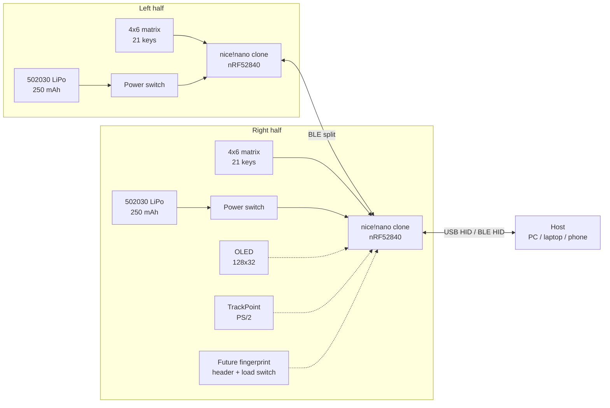
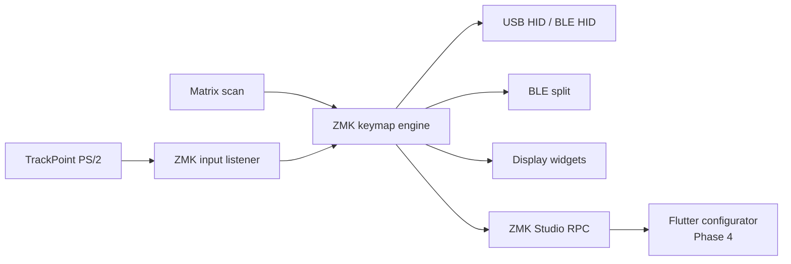

# Architecture

- **Status:** Phase 0 baseline, product-level architecture agreed
- **Last updated:** 2026-11-05
- **Related:** [Requirements](requirements.md), [ADRs](decisions/README.md), [TrackPoint](trackpoint.md), [Bring-up](bringup.md)

## 1. Design principles

1. **Low profile first.** The keycap height is the reference; the controller and battery must not make the keyboard taller than the keycaps.
2. **Serviceable.** The controller is socketed, the battery uses a connector, and switches are hot-swap.
3. **Wireless first, wired fallback.** BLE split is the v1 link; USB is for host connection and charging.
4. **Standard firmware.** ZMK plus modules; no custom fork unless the TrackPoint driver requires it.
5. **Open and attributable.** Hardware is CERN-OHL-S-2.0, firmware is MIT, docs are CC BY 4.0, and Corne attribution is preserved.
6. **Validate before committing.** TrackPoint, battery/RF, and magnet behavior are proven on a breadboard and a v0.1 PCB before the final board.

## 2. System overview



The **right half is the central** because it carries the TrackPoint. With the pinned ZMK/fork revision, v1 keeps the pointing device on the central side; this avoids input-split forwarding and keeps the host USB port on the same half. ZMK has input-split support for pointing devices on peripherals, but v1 does not depend on it. The left half is the peripheral. The right half's USB-C port is the host/data port; the left half's USB-C port is for charging and flashing. The left half does not need an OLED in v1; the right half's display is sufficient. A future dongle can become the central; the TrackPoint could stay on the right half only if the pinned ZMK/fork supports input split, otherwise it must move or the split role/driver behavior must change. That is a Phase 5 design issue.

## 3. Connection modes

| Mode | Between halves | To host | Central | v1 |
|---|---|---|---|---|
| 1 | BLE split | USB HID | Right half | Yes |
| 2 | BLE split | BLE HID | Right half | Yes |
| 3 | BLE split | BLE HID multi-host | Right half | Yes |
| 4 | BLE split | USB dongle | Dongle | No, Phase 5 |
| 5 | Wired UART | USB/BLE | Wired central | No, experimental |

ZMK supports BLE split and USB/BLE host output. Full-duplex wired split is experimental and requires two UART wires with protection; it is not part of v1. A dongle is a ZMK central with no physical keys; it is a Phase 5 option and does not change the v1 hardware. If the TrackPoint stays on the right half, the dongle configuration depends on ZMK input-split support; otherwise the TrackPoint role must change.

## 4. Subsystems

### 4.1 Keyboard matrix

- 42 keys total, 21 per half.
- Per half: 3 rows x 6 columns = 18 matrix keys, plus 3 thumb keys on a fourth row.
- Matrix: 4 rows x 6 columns per half with 21 populated positions; `diode-direction = "col2row"`.
- Diodes: 1N4148W in SOD-123. Through-hole 1N4148 is used only on the breadboard.
- Switches: Kailh Choc V1; hot-swap sockets.
- Key spacing: Choc 18 x 17 mm.
- TrackPoint and mouse buttons occupy the right thumb cluster; the matrix column/row assignment must leave room for the TrackPoint module and its flex.

### 4.2 Controller

- Tenstar/SuperMini nice!nano v2 clone, nRF52840, Pro Micro footprint.
- Socketed with 2.54 mm headers for serviceability.
- 3.2 mm board thickness, mid-mount USB-C, onboard LiPo charger, 3.3 V regulator.
- UF2 bootloader; flashing by copying a `.uf2` file.
- The clone's exact pinout, charger behavior, and current limits must be measured in Phase 1 before the schematic is frozen.

### 4.3 Power

```mermaid
flowchart LR
    USB["USB-C 5 V"] --> CHG["nice!nano charger"]
    BAT["502030 LiPo<br/>250 mAh, protected"] --> SW["On/off switch"]
    SW --> CHG
    CHG --> LDO["3.3 V regulator"]
    LDO --> MCU["nRF52840"]
    LDO --> OLED["OLED"]
    LDO --> TP["TrackPoint"]
    LDO --> EXP["Future fingerprint<br/>load switch"]
    SW -.->|battery ADC (internal VDDH, verify clone)| MCU
```

- One protected 502030 250 mAh cell per half.
- Each half has its own USB-C port, charger, and power switch. The switch is in series with the cell, so it disconnects the battery from the charger and load when off; USB can still power the board. This is the working assumption; the exact charger/switch topology is confirmed in Phase 2.
- Battery voltage is measured by the controller's battery ADC (internal VDDH measurement on the nice!nano v2; the clone may use P0.04/P0.24 or a divider, so verify in Phase 1). Battery percentage is reported by ZMK.
- Deep sleep is enabled; the OLED is off by default; the TrackPoint stays powered only while the half is on.
- The 250 mAh cell and the ≥2 week target imply an average current of ≈0.75 mA. That leaves little headroom for a continuously powered TrackPoint, so its idle/active current is measured in Phase 1 and a load switch or power policy is required if it exceeds the budget.
- The future fingerprint header has a load switch so the 200 mA peak current can be disconnected when idle.
- No VBUS is shared between halves in v1, so there is no backfeed path between them.
- The battery pocket sits under the controller; the antenna end of the controller needs a keepout. The exact battery offset is a Phase 2 mechanical decision.

### 4.4 TrackPoint

- Salvaged Dell TrackPoint module from a Latitude 0D19TR keyboard.
- 4-wire flex, 4-pin 0.5 mm FPC tail, black cap.
- Likely PS/2: VCC, GND, CLK, DATA. Protocol and reset behavior are confirmed in Phase 1.
- Mounted in the right thumb cluster; the cap is operated by the thumb.
- Mouse buttons are right thumb keys, either dedicated or on a pointing layer; scroll is a held thumb layer. The final keymap resolves how the three thumb keys share base-layer keys, clicks, and scroll; this is an open layout question.
- Pull-ups on CLK/DATA; optional RC reset or controlled VCC power-cycle.
- TrackPoint idle current is part of the power budget; a load switch or duty-cycle policy is available if the 3.3 V rail cannot stay powered continuously.
- The ZMK PS/2 driver requires a ZMK fork with mouse support; the tested revision is pinned in `firmware/zmk-config/config/west.yml` when the TrackPoint module is integrated.
- See [TrackPoint](trackpoint.md) for measurements, connector, and test plan.

### 4.5 Display

- v1: 0.91" 128x32 SSD1306 OLED on the right half, I2C, address 0x3C.
- Off by default; a key combination wakes it for 10 seconds.
- Status content: battery, output (USB/BLE), active layer, and connection; security state is added only if a future security feature exists.
- Final PCB includes a nice!view-compatible footprint or adapter path. The OLED (I2C) and nice!view (3-wire SPI) share a 3-GPIO display header; the OLED uses two pins and the nice!view uses all three. The PCB must not require both to be populated.
- The display is low priority for battery life; if the OLED sleep current is too high, a load switch footprint is reserved.

### 4.6 Magnetic mounting

- 4x N52 neodymium magnets per half, embedded in the case bottom.
- Matching 1 mm steel plate with a 1/4"-20 threaded boss.
- Camera-style ball head and clamp provide angle and attachment to a desk, chair arm, or other surface.
- Two alignment pins or a shallow recess prevent rotation.
- The keyboard sits flat on rubber feet for desk use; the magnetic plate is an accessory.
- The mounts are not portable; the keyboard travels without them.
- Magnet size and pull force are finalized after a pull-force test; the target is ≥2x the half's weight.

### 4.7 Mechanical stack

| Layer | Thickness | Notes |
|---|---|---|
| Case bottom | 3–5 mm | Battery pocket under MCU; magnet pockets; feet |
| Hot-swap socket | ~1.5 mm | Below PCB |
| PCB | 1.6 mm | 2-layer, 1.6 mm for socket retention |
| Switch body | ~5.5 mm | Choc V1 |
| Keycap | ~3.5 mm | MBK blank |
| Controller | ~3.2 mm + socket | At top edge, outside keycap area |
| Target total | 15–16 mm | At keycap top; local controller area must stay below |

The controller is placed at the top edge of each half, outside the keycap field. The socket height does not have to dictate the overall height; the battery pocket and case bottom do. A 502030 cell is 5 mm thick; a local pocket under the controller keeps the key area at 15–16 mm while the top edge remains below the keycaps. The table is a component stack, not a simple sum: the hot-swap socket and controller sit in pockets, so the key-area height is measured from the desk to the keycap top on a printed stack-up coupon.

### 4.8 Firmware



- Base: ZMK/Zephyr.
- Split: BLE central (right, with TrackPoint) + peripheral (left). v1 does not rely on input-split forwarding from the peripheral.
- Host: USB HID and BLE HID, multi-host; the right half is the host-facing half.
- TrackPoint: PS/2 driver module; UART-based driver preferred on nRF52; GPIO driver fallback.
- Display: ZMK display widgets; custom 10-second wake behavior.
- ZMK Studio: enabled from v1; unlock binding; runtime keymap editing.
- Custom configuration settings for TrackPoint/display/power can be exposed later through a custom Studio RPC subsystem.
- Baseline firmware uses the in-tree Corne shield for tooling/bring-up; the final shield is custom.

### 4.9 Configurator app

- Flutter, Phase 4, monorepo at `software/configurator`.
- Targets: Android, Linux, Windows, macOS.
- Transport: ZMK Studio serial (USB CDC) and BLE GATT.
- MVP: keymap/layers, keycodes/behaviors, import/export, local profiles.
- Later: combos, macros, tap dances, TrackPoint/display/power settings, BLE profiles, DFU, diagnostics.
- The app uses the documented ZMK Studio protobuf messages; advanced settings require custom RPC modules.

### 4.10 Future security

FIDO2/CTAP2 and fingerprint are deliberately out of v1. The feasible paths are:

1. **Separate security MCU** running OpenSK or a similar FIDO2 stack, connected over USB or an internal hub. The nRF52840 is not a secure element; a dedicated secure element may be required for serious use.
2. **Certified external key** integrated mechanically into the keyboard or dongle. Lowest risk, but not "firmware-defined".
3. **Fingerprint as user verification** via a match-in-sensor module (HLK-ZW0905), with a custom bridge to the FIDO2 stack. This is a research project; the sensor's FAR/FRR and anti-spoof properties must be assessed.

The v1 right PCB reserves a 4-pin UART header and load switch for the fingerprint module, but does not populate it.

## 5. Preliminary pin budget

The exact pin map is frozen at the end of Phase 1 (pin-map gate) and used for the Phase 2 schematic. The table is a feasibility check, not a final assignment.

| Function | Pins | v1 populated | Future |
|---|---:|---|---|
| Matrix rows | 4 | Yes | — |
| Matrix columns | 6 | Yes | — |
| TrackPoint CLK/DATA | 2 | Yes | — |
| TrackPoint reset | 1 | Optional | RC or MOSFET alternative |
| Display header (I2C OLED or SPI nice!view) | 3 | Yes | Shared; OLED uses 2 GPIOs, nice!view uses 3 |
| Battery ADC | 0–1 | Yes | Internal VDDH on nice!nano v2; reserve 1 if the clone uses a divider |
| Fingerprint UART | 2 | No | Header, unpopulated |
| Fingerprint load switch | 1 | No | Header, unpopulated |
| Spare/test points | 1–2 | — | Bring-up |

The nice!nano exposes 21 GPIO. The populated v1 budget is 15–16 pins including the shared display header and an optional TrackPoint reset. The future fingerprint header adds 3 pins, for 18–19; if the clone needs a battery ADC pin, add 1 more (19–20), leaving 1–2 spare GPIO. Confirm that the shared display pins support both I2C and SPI at the pin-map gate. High-frequency pins are preferred for the TrackPoint UART to avoid BLE interference.

## 6. Decision records

- [ADR 0001: Project scope and v1 MVP](decisions/0001-project-scope.md)
- [ADR 0002: Controller and firmware base](decisions/0002-mcu-firmware-base.md)
- [ADR 0003: Connectivity](decisions/0003-connectivity.md)
- [ADR 0004: Low-profile stack and power](decisions/0004-low-profile-power.md)
- [ADR 0005: TrackPoint integration](decisions/0005-trackpoint.md)
- [ADR 0006: Display and power behavior](decisions/0006-display.md)
- [ADR 0007: Magnetic mounting](decisions/0007-magnetic-mount.md)
- [ADR 0008: PCB strategy](decisions/0008-pcb-strategy.md)
- [ADR 0009: Security deferred](decisions/0009-security-deferred.md)
- [ADR 0010: Configurator app](decisions/0010-configurator-app.md)
- [ADR 0011: Automation and toolchain](decisions/0011-automation.md)
- [ADR 0012: Licensing and repository](decisions/0012-licensing.md)

## 7. Open issues

- TrackPoint protocol/reset and contact side.
- TrackPoint idle/active current and power policy.
- Right thumb cluster bindings: base keys vs mouse clicks vs scroll.
- Battery placement vs antenna keepout; battery ADC behavior on the clone.
- Charger/switch topology and off-state current.
- Magnet size and pull force; flat desk seating.
- Exact pin map and high-frequency pin availability.
- TrackPoint driver fork revision; input-split support if a dongle is added.
- ZMK Studio physical layout for the custom shield.
- nice!view footprint/adapter routing.
- Case tolerances and 3D-printer material.
- Future fingerprint/FIDO2 architecture.
