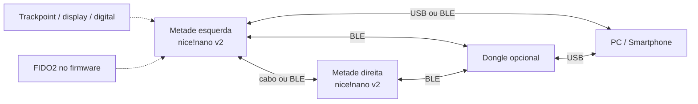

# Arquitetura (rascunho)

> **Status:** rascunho inicial. Este documento registra as ideias e os pontos a decidir; não é uma especificação fechada. O levantamento de requisitos vem depois.

## 1. Visão geral

Teclado split baseado no Corne, com duas metades e um dongle opcional. Cada metade tem um MCU nice!nano v2 (clone, nRF52840), matriz de teclas e bateria. Os periféricos opcionais (trackpoint, display, leitor de digital) ficam em uma das metades, a definir.

Os links do diagrama representam possibilidades; nem todos ficam ativos ao mesmo tempo.

## 2. Modos de conexão

| # | Entre as metades | Até o host | Papel central |
|---|---|---|---|
| 1 | cabo | USB por uma metade | metade ligada ao host |
| 2 | cabo | BLE direto | metade central |
| 3 | BLE | BLE direto | metade central |
| 4 | BLE (cada metade fala com o dongle) | dongle USB | dongle |
| 5 | cabo | uma metade envia ao dongle | metade ligada à outra |

Observações:

- O host pode ser um PC ou smartphone; BLE é o caminho natural para smartphone.
- No modo 4, o dongle agrega as duas metades e apresenta um único dispositivo HID ao host.
- O dongle pode ser USB-A ou USB-C; a definição fica para os requisitos.
- A troca de modo precisa ser previsível e ter um fallback (ex.: cabo USB sempre funciona para carregar e, se possível, para dados).

## 3. Subsistemas

### 3.1 Teclado e matriz

- Corne 3x6+3: 42 teclas, 21 por metade.
- Matriz por metade, com diodos; hotswap ou solda direta a definir.
- O layout e o keymap serão definidos depois.

### 3.2 Link entre metades

- Opção com cabo: UART/serial, conector e proteção a definir (TRRS, USB-C ou outro).
- Opção sem fio: BLE split.
- Cuidados: hot-plug, VBUS, ground loop, detecção de cabo e definição de quem é central.

### 3.3 Link com o host

- USB HID: teclado, mouse (trackpoint) e possivelmente FIDO2.
- BLE HID: teclado e mouse; FIDO2 por BLE é um caso separado (CTAP2 over BLE), não HOGP.
- Dongle: receptor USB que agrega uma ou duas metades.
- Descritores USB e perfis BLE precisam ser planejados para não conflitar.

### 3.4 Dongle

- Terceiro nice!nano v2 (clone) ou módulo nRF52840.
- Sem bateria; alimentado pelo USB do host.
- Função: receber BLE de uma ou das duas metades e apresentar HID composto ao host.
- Validar o suporte atual do ZMK a dongle; se necessário, firmware Zephyr customizado.

### 3.5 Trackpoint

- Definir o módulo: PS/2 (mais simples de integrar) ou analógico (exige front-end e ADC).
- Driver e calibração no firmware; camada de scroll.
- Posição mecânica e botões a definir.

### 3.6 Display

- Priorizar tecnologia de baixo consumo com imagem retida (memory LCD ou e-paper) para ficar “desligado” sem gastar energia.
- Conteúdo: bateria, modo de conexão, camada ativa, status de segurança.
- Acordar por tecla, mudança de conexão ou evento relevante; apagar por timeout.
- nice!view é uma referência de display de baixo consumo para ZMK.

### 3.7 Chave de segurança (FIDO2/CTAP2)

- Objetivo: autenticação multifator no próprio teclado.
- Transportes possíveis: USB HID (mais direto), via dongle e/ou BLE (mais complexo).
- Requer armazenamento seguro de credenciais, PIN, presença/verificação de usuário e, idealmente, atestação.
- O nRF52840 tem recursos de criptografia, mas não é um secure element; para uso sério, avaliar secure element dedicado.
- Pode ser necessário separar a chave de segurança do teclado em outro MCU/placa.
- Este é o subsistema de maior risco e precisa de prova de conceito antes do PCB final.

### 3.8 Leitor de digital

- Sensores com armazenamento de template no próprio sensor simplificam o firmware (ex.: UART, resposta de match).
- No FIDO2, toque é *user presence* e digital é *user verification*; a digital pode cobrir os dois, mas isso precisa ser definido com cuidado.
- Considerar anti-spoof, fallback por botão físico, enrollment e privacidade.

### 3.9 Energia

- Uma bateria LiPo por metade, com carregamento pelo USB de cada metade.
- Medir bateria por ADC; fuel gauge é opcional.
- Evitar backfeed de VBUS entre as metades e ground loops pelo cabo.
- Gerenciamento de energia: deep sleep, display desligado, BLE com latência adequada.
- Definir autonomia alvo e comportamento em USB.

### 3.10 Mecânica

- Case compatível ou derivado do Corne; acomodar trackpoint, display, digital e conectores.
- Definir altura, inclinação, montagem do PCB e acesso aos conectores.
- Se derivado do Corne, preservar licença e atribuição.

## 4. Decisões em aberto

- [ ] Confirmar pinout e características do clone nice!nano v2.
- [ ] Fechar o orçamento de GPIOs (matriz + periféricos + energia).
- [ ] Escolher o conector entre as metades.
- [ ] Definir o tipo de trackpoint e o circuito de interface.
- [ ] Escolher o display e a estratégia de baixo consumo.
- [ ] Escolher o sensor de digital e o modelo de ameaça.
- [ ] Definir transporte e arquitetura da chave FIDO2.
- [ ] Validar ZMK vs. firmware Zephyr customizado para os modos de conexão.
- [ ] Definir topologia de energia e proteção contra backfeed.
- [ ] Definir licença do projeto.

## 5. Próximos passos

1. Levantar requisitos e critérios de aceite.
2. Fazer provas de conceito isoladas (trackpoint, display, digital, FIDO2, dongle).
3. Fechar pinout e esquemático.
4. Projetar PCB e case.
5. Implementar e testar o firmware.
